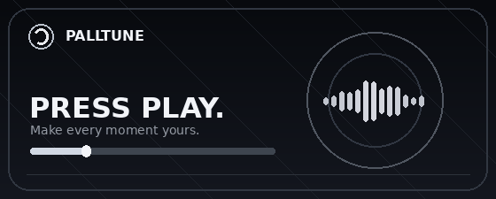

 

# 🎧 PALLTUNE

### **MUSIKMU, SELERAMU.**

*Your music. Your mood. Your way.*

**Cari lagu favorit. Susun playlist. Ikuti lirik. Dengar bareng teman.**

 

 

---

## ✦ Dengerin Musik, Dengan Caramu Sendiri

**PallTune** adalah aplikasi musik untuk Android yang bikin pengalaman mendengarkan lebih personal. Dari menemukan lagu favorit, menyusun playlist, mengikuti lirik, sampai menikmati musik bareng teman — semuanya ada dalam satu tempat.

> **Bukan sekadar putar lagu. Ini ruang buat musik yang kamu suka.**

### ◈ EXPLORE THE EXPERIENCE

**01 / MUSIC PLAYER**  
Cari lagu dan nikmati musik lewat pemutar PallTune.

**02 / YOUR PLAYLIST**  
Simpan dan susun lagu favorit sesuai mood.

**03 / FEEL THE LYRICS**  
Ikuti lirik saat lagu favoritmu diputar.

**04 / LISTEN TOGETHER**  
Nikmati sesi mendengarkan musik bareng teman.

---

## ✨ Apa yang Ada di PallTune?

| 🎵 Musik | 🎧 Pengalaman |
|:---|:---|
| **Cari & Putar Lagu** — temukan lagu atau artis favorit | **Listen Together** — dengarkan musik bersama teman |
| **Playlist** — koleksi lagu sesuai selera | **Lirik** — ikuti lirik sambil mendengarkan |
| **Antrean Lagu** — atur lagu berikutnya | **Personalisasi** — sesuaikan tampilan aplikasi |

## 📱 Download PallTune

**ANDROID APK • GRATIS • V4.3.5**

### [⬇ UNDUH PALLTUNE.APK](https://github.com/PallMods/PallTune-APK/releases/latest/download/PallTune.apk)

**[🌐 BUKA WEBSITE RESMI](https://palltune.vercel.app)**

*Ukuran rilis V4.3.5: sekitar 37,55 MB. Link unduh selalu mengarah ke rilis terbaru.*

### Cara Instal

1. Unduh APK dari tombol di atas.
2. Buka file APK dari folder **Downloads** di HP Android.
3. Periksa sumber dan izin aplikasi, lalu ikuti petunjuk instalasi.

> **Catatan:** Animasi di README ini adalah ilustrasi visual PallTune, bukan rekaman layar atau tampilan aktual APK. Beberapa fitur mungkin memerlukan koneksi internet.

---

### **PALLTUNE**
**MUSIKMU, SELERAMU.**

[Website](https://palltune.vercel.app) · [Download APK](https://github.com/PallMods/PallTune-APK/releases/latest/download/PallTune.apk) · [All Releases](https://github.com/PallMods/PallTune-APK/releases)

Made for the music you love. © PallTune.

