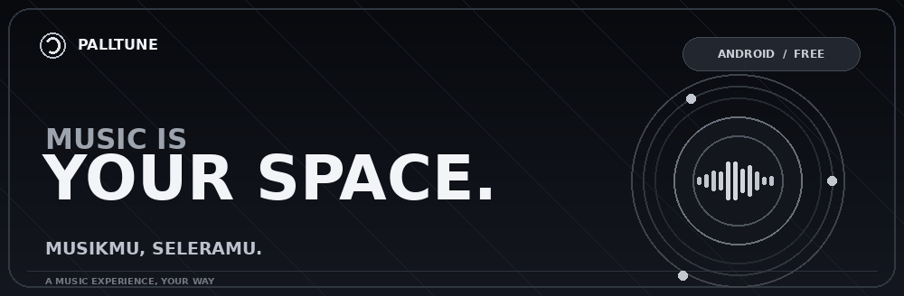
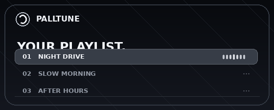
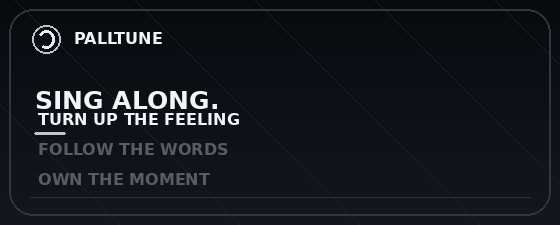
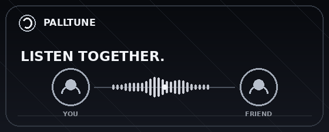
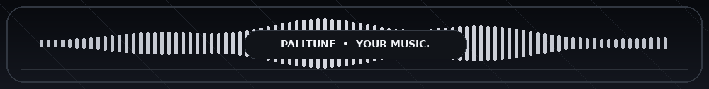

 

### Musikmu, Seleramu.

**Bukan sekadar memutar lagu. Ini ruang buat menikmati musik dengan caramu sendiri.**

Cari musik favorit, susun playlist, nikmati lirik, dan dengerin bareng teman.

 

&nbsp;

  

&nbsp;

&nbsp;

&nbsp;

  

[Explore Features](#-explore-palltune) · [Download Android](#-download-palltune) · [Tentang PallTune](#-tentang-palltune)

---

## ✦ Tentang PallTune

PallTune adalah aplikasi musik Android buat kamu yang pengen menikmati lagu tanpa ribet. Mau putar lagu saat santai, bikin playlist untuk perjalanan, atau berbagi momen lewat musik bareng teman—semuanya dimulai dari satu aplikasi.

**PallTune** membawa pengalaman musik yang personal dengan gaya visual sederhana, modern, dan nyaman dipakai.

> **Your music. Your mood. Your choice.**  
> Musikmu, Seleramu.

 

## ✦ Explore PallTune

  Empat suasana, satu tempat untuk musikmu.

 

<table>
<tr>
<td width="50%" valign="top" align="center">

### ♫ Music Player

Putar lagu favoritmu, nikmati suasananya, dan atur perjalanan musik sesuai keinginan.

</td>
<td width="50%" valign="top" align="center">

### ▤ Your Playlist

Kumpulin lagu yang kamu suka, susun playlist, dan putar musik sesuai mood.

</td>
</tr>
<tr>
<td width="50%" valign="top" align="center">

### ♬ Lyrics

Bukan cuma dengar—ikuti lirik dan nikmati setiap bagian dari lagu favoritmu.

</td>
<td width="50%" valign="top" align="center">

### ◎ Listen Together

Ada lagu yang lebih seru kalau didengar bareng. Berbagi momen musik dengan teman.

</td>
</tr>
</table>

  Animasi di atas adalah visual promosi original, bukan screenshot langsung dari aplikasi.

 

## ✦ Semua yang Kamu Butuhkan untuk Musik

| | FITUR | DESKRIPSI |
|:---:|---|---|
| 01 | **Search & Play** | Cari lagu atau artis favorit dan mulai mendengarkan. |
| 02 | **Personal Playlist** | Simpan serta atur koleksi lagu sesuai selera. |
| 03 | **Lyrics** | Ikuti lirik saat musik diputar. |
| 04 | **Listen Together** | Nikmati pengalaman mendengarkan bersama teman. |
| 05 | **Music Queue** | Atur antrean lagu yang akan diputar berikutnya. |
| 06 | **Personalization** | Sesuaikan tampilan dan suasana aplikasi. |

 

**SET THE MOOD. PLAY YOUR MUSIC.**

 

## ↓ Download PallTune

### Musik favoritmu tinggal satu download.

**Android APK · Gratis · Rilis V4.3.5**

 

  

[**Lihat semua versi**](https://github.com/PallMods/PallTune-APK/releases) · [**Buka website resmi**](https://palltune.my.id)

### Cara instal di Android

1. Unduh file **PallTune.apk** lewat tombol di atas.
2. Buka file APK dari folder **Download** di HP.
3. Ikuti instruksi Android untuk memasang aplikasi. Periksa sumber file serta izin aplikasi sebelum menginstal.
4. Buka **PallTune** dan nikmati musikmu.

 

## ? Frequently Asked Questions

<b>Apakah PallTune gratis?</b>

 
Ya. PallTune ditujukan sebagai aplikasi musik gratis.

<b>Bagaimana cara download PallTune?</b>

 
Klik tombol <b>Download for Android</b> di atas. File APK diunduh melalui GitHub Releases.

<b>Apa itu Listen Together?</b>

 
Fitur untuk menikmati musik bersama teman melalui pengalaman mendengarkan bersama.

<b>Bagaimana kalau ada versi baru?</b>

 
Tombol download di halaman ini mengarah ke rilis PallTune terbaru yang tersedia.

 

---

### PALLTUNE

**MUSIKMU, SELERAMU.**

A little more music, a lot more feeling.

 

<a href="https://palltune.my.id">Official Website</a> · <a href="https://github.com/PallMods/PallTune-APK/releases/latest/download/PallTune.apk">Download APK</a> · <a href="https://github.com/PallMods/PallTune-APK/releases">Releases</a>

  

© 2026 PallTune · PallMods

---

## PallX Projects — Official Developer

**PallX** develops **PallTune** (music application / aplikasi musik) and **CatGhost** (WhatsApp management application / aplikasi manajemen WhatsApp).

[Official PallX Profile](https://palltune.my.id/pallx/) · [Public Developer Information](PALLX.md)
